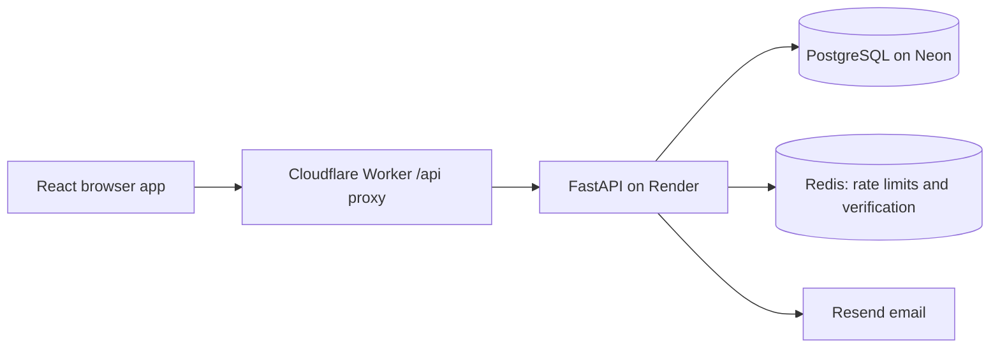

# Rollcall

**Attendance, coursework and academic records in one institution-managed workspace.**

Rollcall is a multi-tenant learning management application built with React, FastAPI and PostgreSQL. It connects the daily work of students, teachers, institution administrators and platform administrators, with access checked by role and institution on the server.

[Open Rollcall](https://rollback.mahaba955.workers.dev) · [User guide](docs/USER_GUIDE.md) · [Engineering portfolio](docs/PORTFOLIO.md)


## What you can do

| Workspace | Implemented capabilities |
| --- | --- |
| Student | View enrolled subjects and published materials; save assignment drafts and submit written answers or document links; view personal attendance, scores, feedback and a read-only profile. |
| Teacher | View assigned subjects; publish resources and coursework; record attendance and marks; review submitted work. Class supervisors also create student accounts, correct details and manage enrollment for their classes. |
| Institution administrator | Configure classes and subjects; invite and manage teachers; manage students and accounts; oversee academic records; update institution settings and review administrative audit events. |
| Platform administrator | Create and manage institutions and their administrators; suspend accounts or institutions; view usage and audit events; archive institutions through email verification. |

Accounts are provisioned by authorised staff. There is no public self-registration. Request access from your institution; production credentials are never published in this repository.

## Architecture



The browser uses same-origin `/api` requests. FastAPI validates the session and current account status, then enforces institution membership and teaching/enrollment relationships. Composite database constraints reinforce institution boundaries. Alembic manages schema changes. React Query manages fetched state and clears cached account data when authentication changes.

Production uses Cloudflare Workers for the frontend, Render for the API and Redis, and Neon for PostgreSQL. Netlify and Vercel configuration files are alternative hosting configurations, not additional required services.

## Run locally

Requirements: Python 3.11+, Node.js 22.12+ (or a compatible newer release), PostgreSQL and Redis. Use your own development database; do not point local experimentation at production.

### Backend

From `backend/`:

```sh
python -m venv venv
# Windows PowerShell: .\venv\Scripts\Activate.ps1
# macOS/Linux: source venv/bin/activate
pip install -r requirements-dev.txt
```

Copy `backend/.env.example` to `backend/.env` and replace the database and signing-secret placeholders. Generate a random signing secret locally, for example with `python -c "import secrets; print(secrets.token_urlsafe(48))"`. Never commit the resulting environment file.

```sh
alembic upgrade head
python seed_super_admin.py
uvicorn app.main:app --reload
```

The bootstrap script prompts for the first platform administrator and refuses to create another when one already exists. Email invitation, recovery and verification workflows require a valid `RESEND_API_KEY` and sender address. They do not silently succeed without email configuration.

### Frontend

From `frontend/`:

```sh
npm ci
npm run dev
```

Open `http://localhost:5173`. Vite proxies `/api` to `http://127.0.0.1:8000`. The API health endpoint is `/health`; development API documentation is available at `/docs`.

### Optional sample records

[Dataset guide](backend/SAMPLE_DATA.md) explains the realistic sample institutions and learning records. The generator retains its historical filename; displayed institution and account names do not use a “demo” prefix.

From `backend/`, set `SEED_DATABASE_URL` securely to your development PostgreSQL connection, then preview the transaction:

```sh
python scripts/seed_demo.py --expected-host YOUR_DATABASE_HOST
# Explicitly apply to the same development database and choose a password privately:
python scripts/seed_demo.py --expected-host YOUR_DATABASE_HOST --apply --password
```

The default run rolls back. An applied run inserts missing generator-owned records without deleting existing data. Normal reruns preserve existing passwords and edits. Never publish passwords or generated account directories.

## Verification

From `backend/`:

```sh
python -m pytest tests -q
```

From `frontend/`:

```sh
npm run lint
npm run build
node --test tests/*.test.js
```

Backend tests use isolated SQLite fixtures, including foreign-key enforcement, and replace external services. They cover tenant and role restrictions, supervision, enrollment, attendance, coursework, submissions, administrative actions and seed repeatability. They do not replace PostgreSQL migration validation or live email testing. Validate migrations on an isolated PostgreSQL branch before applying them to production.

## Deployment

- Build frontend assets with `npm ci && npm run build` in `frontend/`. The Worker configuration is `frontend/wrangler.jsonc`; its API destination is configured in `frontend/worker.js`.
- `render.yaml` defines the API and Redis deployment. Its build runs Alembic migrations: review and validate migrations before deploying.
- Set `DATABASE_URL` (pooled) and `DATABASE_URL_UNPOOLED` (direct migration connection) from the same database branch in the hosting secret settings.
- Set `JWT_SECRET_KEY`, `REDIS_URL`, `ENVIRONMENT=production`, `ALLOWED_ORIGINS` and `FRONTEND_BASE_URL`. Both frontend URL settings must match the actual deployed site. Configure Resend separately for email workflows.
- Smoke-test all four roles after deployment. A successful build alone does not confirm email delivery or database connectivity.

## Scope and next steps

This is a working learning-management project, not a complete replacement for Moodle. Current submissions use text and document links; binary uploads, discussion forums, automated quizzes, notifications, billing, offline synchronisation and comprehensive analytics are not implemented. Audit coverage focuses on administrative events. Automatic session refresh is not implemented; expired sessions require signing in again.

The current academic model uses classes, subject assignments and enrollment. Semester scheduling and university degree/programme structures would require additional modelling. Priorities for further work include file storage with access controls, session renewal, broader accessibility testing and measured usability trials.

## Repository layout

```text
backend/app/          API routes, models, schemas, access controls and services
backend/alembic/      Database migrations
backend/tests/        Isolated API and data-integrity tests
backend/scripts/      Sample dataset and migration validation tools
frontend/src/         Role workspaces, public pages and shared UI
frontend/tests/       Routing, learning helpers and password validation tests
docs/                 User guide and engineering portfolio
```

See [SECURITY.md](SECURITY.md) for public-file boundaries and responsible reporting. No licence is currently specified; public visibility alone does not grant unrestricted reuse rights.
