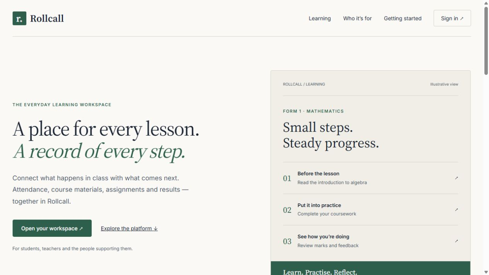
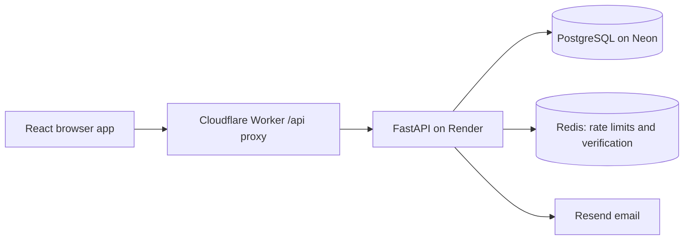

# Skynet (formerly Rollcall)

**Attendance, coursework and academic records in one institution-managed workspace.**

Skynet is a multi-tenant learning management application built with React, FastAPI and PostgreSQL. It connects the daily work of students, teachers, institution administrators and platform administrators, with access checked by role and institution on the server.

[Open Rollcall](https://rollback.mahaba955.workers.dev) · [User guide](docs/USER_GUIDE.md) · [Engineering portfolio](docs/PORTFOLIO.md)



## What you can do

| Workspace | Implemented capabilities |
| --- | --- |
| Student | View enrolled subjects and published materials; save assignment drafts and submit written answers or document links; view personal attendance, scores, feedback and a read-only profile. |
| Teacher | View assigned subjects; publish resources and coursework; record attendance and marks; review submissions and release results. Class supervisors correct basic details, manage enrollment and review all subject marks for their classes. |
| Institution administrator | Configure terminology and grading; manage classes, subjects and teachers; provision email or ID-only student accounts; reset student credentials; oversee records, settings and audit events. |
| Platform administrator | Search/open institutions and their workspaces; view actual charts; manage monthly KES subscriptions, received payments and overdue/manual freezes; manage access and audit events; archive institutions through email verification. |

Accounts are provisioned by authorised staff. There is no public self-registration. Request access from your institution; production credentials are never published in this repository.

## Architecture



The browser uses same-origin `/api` requests. FastAPI validates the session and current account status, then enforces institution membership and teaching/enrollment relationships. Composite database constraints reinforce institution boundaries. Alembic manages schema changes. React Query manages fetched state and clears cached account data when authentication changes.

Production uses Cloudflare Workers for the frontend, Render for the API and Redis, and Neon for PostgreSQL. Netlify and Vercel configuration files are alternative hosting configurations, not additional required services.

## Sign in

The homepage and `/sign-in` show the Skynet staff login from the supplied design. Choose Teacher or Admin; Admin covers both platform and institution administrators. `/login` opens the same page with Admin selected, and `/teacher/login` opens it with Teacher selected. Pupils use the matching separate page at `/student/login`.

Staff sign in with email and password. Institution administrators choose email or a globally unique student ID for each pupil; pupils enter the assigned identity on the student page. ID-only pupils do not need an email and use administrator-assisted password recovery. Usernames remain internal records. Email matching is case insensitive and a database index rejects case-only duplicates. Role, institution and mandatory first-password restrictions are enforced by the API.

Remember me controls persistent versus browser-session cookies. New sessions renew automatically within an absolute refresh lifetime; logout and credential changes revoke access. Redis is required for sensitive endpoints: if rate limiting is unavailable, the API returns 503 with a retry hint. Login attempts share an IP limit across all three endpoints. API responses use `Cache-Control: no-store`. See [Pilot workflows](docs/PILOT_WORKFLOWS.md) for sessions, private work recovery, reviewed student imports and academic year transitions.

Education navigation opens a product enquiry dialog with the category selected. Enquiries are delivered by the existing Resend service to `PRODUCT_ENQUIRY_EMAIL`; configure that inbox together with `RESEND_API_KEY` and a verified `EMAIL_FROM_ADDRESS` in each environment. Failed or unconfigured delivery returns an error, never a success message. The public endpoint is rate limited and does not create accounts.

## Run locally

Requirements: Python 3.11+, Node.js 22.12+ (or a compatible newer release), PostgreSQL and Redis. Use your own development database; do not point local experimentation at production.

### Backend

From `backend/`:

```sh
python -m venv venv
# Windows PowerShell: .\venv\Scripts\Activate.ps1
# macOS/Linux: source venv/bin/activate
pip install -r requirements-dev.txt
```

Copy `backend/.env.example` to `backend/.env` and replace the database and signing-secret placeholders. Generate a random signing secret locally, for example with `python -c "import secrets; print(secrets.token_urlsafe(48))"`. Never commit the resulting environment file.

```sh
alembic upgrade head
python seed_super_admin.py
uvicorn app.main:app --reload --port 8010
```

The bootstrap script prompts for the first platform administrator and refuses to create another when one already exists. Email invitation, recovery and verification workflows require a valid `RESEND_API_KEY` and sender address. They do not silently succeed without email configuration.

### Frontend

From `frontend/`:

```sh
npm ci
npm run dev
```

Open the local URL printed by Vite (currently `http://127.0.0.1:5174`). Vite proxies `/api` to this project's FastAPI server at `http://127.0.0.1:8010`. Port 8000 is used by another local project. The API health endpoint is `/health`; development API documentation is available at `/docs`.

### Optional sample records

[Dataset guide](backend/SAMPLE_DATA.md) explains the realistic sample institutions and learning records. The generator retains its historical filename; displayed institution and account names do not use a “demo” prefix.

From `backend/`, set `SEED_DATABASE_URL` securely to your development PostgreSQL connection, then preview the transaction:

```sh
python scripts/seed_demo.py --expected-host YOUR_DATABASE_HOST
# Explicitly apply to the same development database and choose a password privately:
python scripts/seed_demo.py --expected-host YOUR_DATABASE_HOST --apply --password
```

The default run rolls back. An applied run inserts missing generator-owned records without deleting existing data. Normal reruns preserve existing passwords and edits. Never publish passwords or generated account directories.

## Verification

From `backend/`:

```sh
python -m pytest tests -q
```

From `frontend/`:

```sh
npm run lint
npm run build
node --test tests/*.test.js
```

Backend tests use isolated SQLite fixtures, including foreign-key enforcement, and replace external services. They cover tenant and role restrictions, supervision, enrollment, attendance, coursework, submissions, administrative actions and seed repeatability. They do not replace PostgreSQL migration validation or live email testing. Validate migrations on an isolated PostgreSQL branch before applying them to production.

## Deployment

For upgrading the existing live site, use the [staged live deployment runbook](docs/DEPLOYMENT.md). Begin troubleshooting at the [maintenance handbook](docs/MAINTENANCE.md).

- Build frontend assets with `npm ci && npm run build` in `frontend/`. The Worker configuration is `frontend/wrangler.jsonc`; its API destination is configured in `frontend/worker.js`.
- `render.yaml` defines the API and Redis deployment. Its build runs Alembic migrations: review and validate migrations before deploying.
- Set `DATABASE_URL` (pooled) and `DATABASE_URL_UNPOOLED` (direct migration connection) from the same database branch in the hosting secret settings.
- Set `JWT_SECRET_KEY`, `REDIS_URL`, `ENVIRONMENT=production`, `ALLOWED_ORIGINS` and `FRONTEND_BASE_URL`. Both frontend URL settings must match the actual deployed site. Configure Resend separately for email workflows.
- Smoke-test all four roles after deployment. A successful build alone does not confirm email delivery or database connectivity.

## Scope and next steps

Current submissions use text and document links. Binary uploads, discussion forums, automated quizzes, general notification feeds, M-Pesa collection, offline synchronisation and comprehensive analytics are not implemented. Manual subscription payments, request-time freezing and a deployable reminder worker are implemented. Audit coverage focuses on administrative events. Sessions renew automatically; an ended refresh session offers reauthentication while preserving the open workspace.

See [Institution product operations](docs/INSTITUTION_PRODUCT.md) for configuration, payment rules, reminder deployment and the isolated local preview. This implementation has not been deployed to the hosted database.

Platform institution filters, detailed audit logs, Billing, signed backups and reviewed recovery are described in [Platform operations](docs/PLATFORM_OPERATIONS.md). Full database recovery uses a separate empty PostgreSQL destination and does not overwrite the running database.

The academic model supports configurable programmes/levels/catalogue courses, individual registrations, terms/semesters, year activation/closure, report cards/transcripts, approved final grades/GPA and reviewed individual progression with retake/prerequisite rules. Legacy whole-class promotion remains available when individual progression is disabled. See the [prioritised roadmap](docs/ROADMAP.md) for remaining work and acceptance criteria.

## Repository layout

```text
backend/app/          API routes, models, schemas, access controls and services
backend/alembic/      Database migrations
backend/tests/        Isolated API and data-integrity tests
backend/scripts/      Sample dataset and migration validation tools
frontend/src/         Role workspaces, public pages and shared UI
frontend/tests/       Routing, learning helpers and password validation tests
docs/                 User guide and engineering portfolio
```

See [SECURITY.md](SECURITY.md) for public-file boundaries and responsible reporting. No licence is currently specified; public visibility alone does not grant unrestricted reuse rights.

Student progression, retakes and prerequisite configuration: see [Student progression](docs/STUDENT_PROGRESSION.md).
