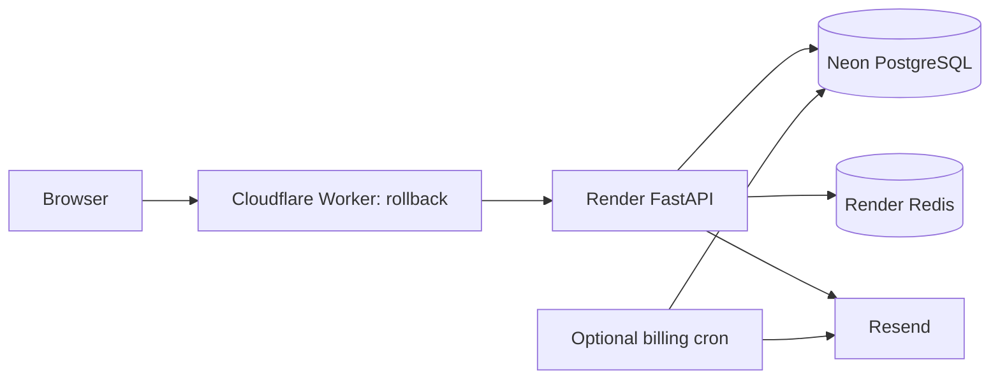

# Upgrade the existing live deployment

Prepared 28 October 2026 from repository configuration. This document is a release procedure, not evidence that an upgrade has happened. The original project is live; the current working tree's feature tests were local. Hosting dashboards, deployed commit, database revision, restore retention and actual secret values have not been inspected for this handover.

For the ordered command checklist, use [Deployment and migration process](DEPLOYMENT_MIGRATION_PROCESS.md).

## Existing deployment path



| Component | Repository evidence | Confirm before release |
| --- | --- | --- |
| Frontend | frontend/wrangler.jsonc: worker `rollback`, assets `dist`, SPA fallback | Actual Cloudflare account, Worker/custom domains, live version and rollback version |
| API proxy | frontend/worker.js: hard-coded `https://learning-management-system-5nws.onrender.com`; only `/api/` is proxied | Actual production destination; staging must use a separate origin |
| API/Redis | render.yaml: `learning-management-system-5nws`, backend root, Uvicorn, Redis binding | Linked repository/branch, deployed commit, auto-deploy policy, runtime and configured secrets |
| Database | README and connection settings: PostgreSQL on Neon | Project, branch, database, role, actual Alembic revision, recovery retention and available capacity |
| Billing notices | deploy/render-billing.yaml, hourly cron | Whether deployed; which DB and sender it uses; dry-run outcome |

The README lists `https://rollback.mahaba955.workers.dev` as the site. Treat it as repository configuration until confirmed in the hosting account. This work did not change DNS or deploy the site.

## 1. Establish a release baseline

Record the current frontend/API version and database revision using OPERATIONS_RECORDS.md. Inspect hosting auto-deploy settings before pushing any release commit: `render.yaml` currently runs `alembic upgrade head` inside the build command, so a build can change the database even if the new API never becomes healthy. Do not push unreviewed migrations onto the linked live branch.

Record all changed and untracked release files with `git status --short`; there are substantial local changes. Include new migrations/models/routes/tests and docs in the reviewed release. Exclude `.env*`, local account directories, database dumps, private logs, QA screenshots containing personal data and machine-specific helpers. Record an immutable commit and the exact frontend artifact built from it. Do not seed sample users into production or rerun the platform-admin bootstrap on an established installation.

## 2. Rehearse in staging

Create an isolated PostgreSQL branch/database starting from the actual live schema or a securely controlled restored backup. Prefer schema-only/synthetic data for general testing; restrict access and disable outbound delivery if a real-data copy is required. Keep staging API, Redis namespace/service, signing secrets, sender/recipients and frontend separate from production.

The Worker API origin is hard-coded; a staging Worker copied unchanged would call production. Prepare a separately reviewed staging config/Worker entry pointing to the staging API and unique Worker name. Do not overwrite production worker.js just to test locally. Parameterising origins with explicitly validated per-environment configuration is roadmap work.

From backend, after securely selecting BOTH database URLs for the same staging database:

```powershell
python -m alembic current
python -m alembic heads
python -m alembic history
python -m alembic upgrade head
python -m alembic check
python -m pytest tests -q
```

Current source head is `j2f3a4b5c6d7` (progression); verify with `heads` rather than assuming the live starting revision. Never use `stamp head` to hide missing migrations. Check both URLs: runtime may use a pooled URL while migrations use the direct URL. `alembic/env.py` reads DATABASE_URL_UNPOOLED from the process environment, falling back to settings.DATABASE_URL only when the variable is absent; do not leave it set to an empty string or another branch. Provider commands and secrets belong in hosting settings, not in Git.

From frontend:

```powershell
npm ci
npm run lint
node --test tests/*.test.js
npm run build
```

Rehearse the exact upgrade from the live starting revision, not only from an empty database. Check existing users, duplicate/case-variant emails, old enrollments, historical marks and institution settings. Use a synthetic institution for new functionality and capture timings. The historical local baseline was 301 backend/31 frontend tests; regenerate evidence for the release commit. Connected browser fixture helpers used during development are ignored and not yet a portable test suite.

## 3. Verify production configuration and recovery

| Setting/tool | Requirement |
| --- | --- |
| DATABASE_URL / DATABASE_URL_UNPOOLED | Same intended database/branch, correct runtime/direct connection; verify privately |
| JWT_SECRET_KEY | Strong existing production secret, shared consistently; changing it signs out users |
| ENVIRONMENT | production; HTTPS required for secure cookies |
| ALLOWED_ORIGINS / FRONTEND_BASE_URL | Exact real HTTPS frontend origin; test login and recovery links through Worker |
| REDIS_URL | Reachable intended service; unavailable limits intentionally block sensitive endpoints |
| RESEND_API_KEY / EMAIL_FROM_ADDRESS | Valid key and verified sender; controlled delivery test |
| PRODUCT_ENQUIRY_EMAIL | Confirm recipient; configured contact inbox is required for successful enquiries |
| BILLING_SUPPORT_EMAIL | Confirm support contact; currently defaults to mahaba955@gmail.com |
| BACKUP_SIGNING_KEY | Dedicated strong production key, retained securely alongside key-version records; needed to read old archives |
| PG_DUMP_PATH / PG_RESTORE_PATH or PATH | Compatible PostgreSQL client binaries actually installed; Python dependencies alone do not supply them |
| RESTORE_DATABASE_URL | Optional separate empty recovery target; never the running DB |
| ACCESS_TOKEN_EXPIRE_MINUTES / REFRESH_TOKEN_EXPIRE_DAYS | Confirm intended lifetimes from config.py; stable settings across API instances |

Take an encrypted/offsite recoverable pre-release database backup, record its timestamp and checksum privately, and prove restoration to a separate destination. A signed tenant export does not replace a full database recovery copy. Record acceptable recovery time and data loss. Ensure billing cron or outbound email does not run against an unintended restored/staging database.

## 4. Perform the controlled live upgrade

1. Agree a maintenance window and notify institutions through an approved operational channel. Stop writes at the edge/API or place the live service in controlled maintenance using an available hosting mechanism. No application maintenance switch is currently implemented. Confirm ordinary clients and scheduled writers cannot continue changing data during cutover.
2. Pause automatic deployments/scheduled jobs as appropriate and record the last good frontend/API versions. Take the final pre-migration backup after writes stop.
3. Use one designated migration runner against the verified production database. Run `python -m alembic current`, `upgrade head`, and `check`, retaining redacted output. If migrations fail, keep maintenance active and diagnose; do not repeatedly deploy or stamp past the failure.
4. Deploy the matching API commit. The current Render build repeats `upgrade head`; after the controlled migration it should be a no-op. A preferable follow-up is a dedicated release/pre-deploy migration stage where hosting supports it, with dependency install as build-only. Do not assume that stage is already configured.
5. Confirm API `/health` and authenticated API operations. `/health` currently reports process health only, not readiness of database, Redis or Resend. Existing frontend compatibility with the new API must be checked before this sequence is approved; if incompatible, keep maintenance active through frontend deployment.
6. From the reviewed frontend release artifact/config, deploy the existing intended Worker using the approved Cloudflare CLI/dashboard workflow. Wrangler is not pinned in package.json: select and record a reviewed CLI version in the release toolchain. For a configured Wrangler installation, `wrangler deploy` runs from frontend. A deployment command publishes; it is not a preview command.
7. Run the smoke checks below through the real frontend origin. Resume jobs and remove maintenance only after checks pass. Start with a controlled pilot institution; enable academic/progression policy only after customer rules are confirmed. Defaults must not be interpreted as official national grading criteria.

## 5. Smoke checks and observation

- Direct navigation/reload of nested role pages, desktop and phone layout, HTTPS and no browser script errors.
- Staff email and assigned learner ID/email sign-in; wrong-role denial, first-password flow, refresh, logout and revoked session.
- Two synthetic institutions: cross-tenant records denied; teacher assigned classes only; delegated teacher/admin views remain read-only as designed.
- Save/recover unfinished work; preview and commit a small student import; reject a bad batch without partial creation.
- Coursework/material visibility, submission, attendance, marks; withheld outcomes invisible to students; approve/release and verify report/GPA values against a known example.
- Progression preview, stale-review rejection, advancement/repetition/completion, prerequisite/retake rejection and preserved source history.
- Manual subscription payment/due date and freeze/unfreeze on a synthetic institution only. Verify grace and support message; do not test by freezing a real customer.
- Audit event with action/IP/detail; signed backup export and controlled recovery rehearsal; invitation/recovery/contact email to an agreed test mailbox.
- Observe error rates, response time, database/Redis capacity, email failures and cron logs against agreed thresholds. Monitoring thresholds and alert ownership must be established before release.

## 6. If deployment fails

Keep maintenance active if integrity or authentication is uncertain. Preserve logs, commit IDs, migration revision and backup references. If the schema remains compatible, redeploy the last known-good API/frontend artifacts and smoke-test before reopening. Application rollback does not undo database migrations.

Do not run a broad Alembic downgrade on production as a generic rollback. Several migrations refuse to drop populated academic/history data. Prefer a reviewed forward repair. If recovery is necessary, restore the pre-release backup into a separate database, verify it and deliberately switch API connections after confirming the data-loss window. Post-backup writes need reconciliation; replacing data silently is unacceptable. Keep the affected database available for investigation under controlled access. Record all actions and follow-up defects.

## Provider references

Repository settings determine the project-specific procedure above. Provider features/account availability must be confirmed before release: [Render deploy behaviour and auto-deploy controls](https://render.com/docs/deploys), [Cloudflare Wrangler commands](https://developers.cloudflare.com/workers/wrangler/commands/), [Neon branches](https://neon.com/docs/manage/branches). Provider documentation reviewed 28 October 2026; do not store secret deploy hooks in release records.
