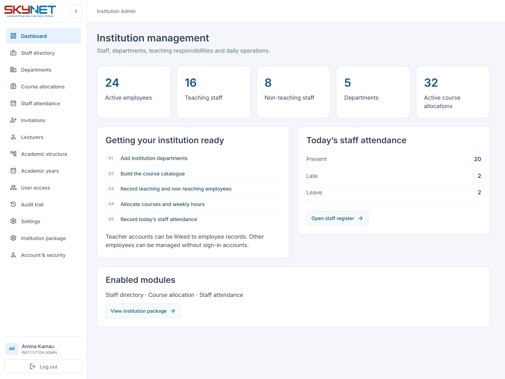
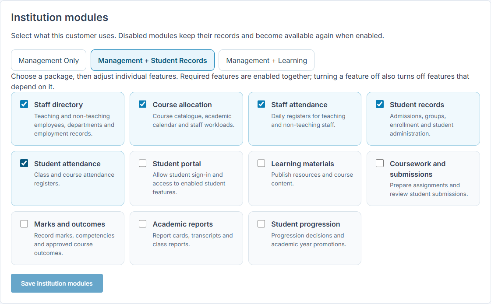

# Institution management and optional learning

The same installation supports customers who need employee and academic administration, student record keeping, or online learning. Institution type (school, college, university, etc.), academic policy, enabled modules, and account permissions are separate settings.

## Packages

| Package | Includes |
| --- | --- |
| Management Only | Staff directory, departments, course catalogue and allocation, academic calendar, staff attendance |
| Management + Student Records | Management plus student records, enrollment and student attendance; no student portal or online coursework |
| Management + Learning | All implemented modules, including student access, materials, coursework, outcomes, reports and progression |

Platform administrators select a package during institution creation or change **Institution modules** on the institution details page. Individual switches allow custom combinations. The editor enables prerequisites automatically and turns dependent features off when their prerequisite is disabled. The server independently validates these relationships. Institution administrators can inspect their package but cannot change their entitlement.

Existing institutions with empty module settings retain full functionality. Selecting a package does not change institution type, academic structure, grading rules or billing. Subscription amounts remain explicitly configured by the platform administrator.

## Management workflows

1. Create academic and support departments in **Departments**, available even without programme-based academic structure.
2. Add teaching and non-teaching employees in **Staff directory**. Store staff number, department, job title, employment type, status, joining date and contact details. These records do not create login accounts. Link an existing active teacher account when an employee needs educator access. Employee contact information and account identity are managed independently.
3. Create courses in **Academic structure → Course catalogue**.
4. Use **Course allocations** to assign a teaching employee, catalogue course, period, optional group/section and weekly hours. Allocations require no students, enrollments or submissions. Reuse a consistent period name. Duplicate employee/course/period/group combinations are rejected; combined active hours cannot exceed 168 in one period. End an allocation to retain its history. End active allocations before placing an employee on leave, changing them to non-teaching staff or marking them inactive.
5. Use **Staff attendance** to mark a date with Present, Absent, Late, On leave or Off duty, optionally with a note. Unmarked employees are not treated as present. Bulk marking affects only eligible, unmarked employees on the displayed page. New attendance cannot precede the joining date or use a future date. Historical records for inactive staff remain visible. A conflicting entry rejects the entire batch.

Linked teachers see only their own staffing allocations in **My course allocations**. Institution administrators manage employee records, allocations and attendance. Existing teacher invitations and account security controls continue to govern educator login. Employment status and login-account status are separate; use account access controls when an employee must lose sign-in access.

Staffing allocations plan employee workloads. **Classes & teaching** continues to attach teachers and course offerings to actual student groups when student records are enabled. A staffing allocation does not automatically create a student group, publish materials, enroll students or create a class course offering.

## Student records and sign-in

Student enrollment can exist without portal access. In the class roster, administrators can create a student with **Enable student sign-in** off. When the institution's portal is disabled, new students and imports receive no sign-in access or credentials. Internally, the existing user identity continues to anchor names and academic history; its `login_enabled` flag blocks authentication and refresh.

Enabling a package later does not automatically enable those records. An administrator explicitly enables each student's sign-in, assigns the login identity and resets their password to issue credentials. Disabling individual sign-in revokes practical access immediately; disabled users cannot be opened through delegated workspaces. Changing student identities also invalidates earlier sessions.

Disabling the institution's student portal blocks existing student sessions and refreshes. Account logout and password/security endpoints remain available where the account itself remains enabled. Imports must be previewed again if portal availability changes between review and commit.

## Enforcement and preservation

- Modules apply to the institution; role, tenant membership and existing teaching/enrollment relationships still control each action.
- Navigation, direct page access, dashboard links and API routes follow module availability. Checks run for delegated workspaces too.
- Configuration and security endpoints remain accessible so administrators can inspect the package and manage accounts.
- Turning off a module preserves its records. Turning it back on restores access to the same records.
- Updates require the version loaded by the editor. Concurrent changes return a conflict instead of overwriting another administrator's work.
- Employee, department, allocation, attendance and module mutations are audited. Institution backups include module settings and new management records; restore inserts departments and employees before dependent records.

## Upgrade and validation

Apply Alembic revision `k3a4b5c6d7e8` through the normal deployment workflow. It adds institution module settings, the user login flag and three management tables, with institution-scoped foreign keys and unique constraints. It preserves existing account access. Downgrade refuses to discard management records, configured modules or disabled-login controls.

HTTP tests in `backend/tests/test_management.py` cover presets, dependencies, authorization, tenant boundaries, delegated access, session restrictions, employee updates, allocations, workload limits, atomic attendance, record-only student creation and backup recovery. Frontend tests cover package navigation and dependency changes. Validate the migration on an isolated PostgreSQL database before deployment.

This implementation does not include payroll, employee self-service, leave approval workflows, timetable conflict detection or custom permission-role creation. Staff records and a leave attendance status do not imply those workflows exist.
